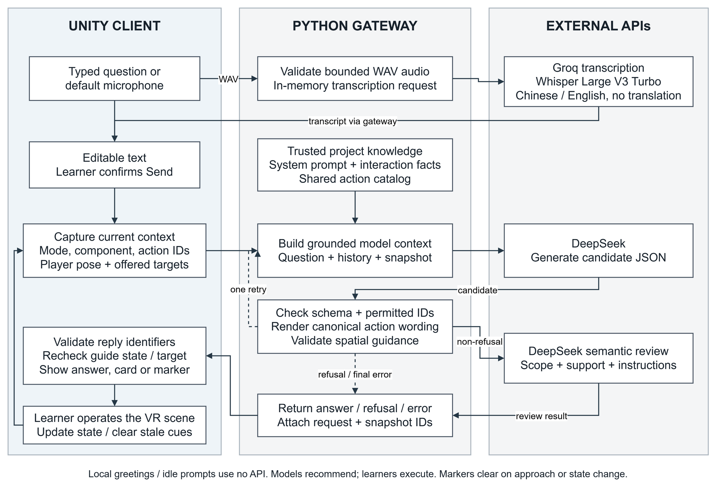

# VRMicroscope：融合交互式显微仿真与任务状态感知 AI 指引的虚拟现实教学系统

**作者：**Tang Shaoyan$^{1,*}$，Pu Yunpin$^2$，Sui Si‘ao$^2$，Qammer Abbasi$^3$，Sajjad Hussain$^3$，Hu Min$^2$，Hasan Abbas$^{3,*}$  
**单位：**$^1$新加坡国立大学，新加坡；$^2$电子科技大学，中国；$^3$格拉斯哥大学，英国  
**通讯作者：**Tang Shaoyan (tangshaoyan@u.nus.edu)，Hasan Abbas (Hasan.abbas@glasgow.ac.uk)

> **【编辑标注说明｜提交前移除】** 图 1、图 2 和图 4 已嵌入 `Pic/` 中提供的运行时截图。图 3 已补齐 draw.io 原创矢量架构图，固定状态后端回归结果以表 5 呈现。图片选择和剩余检查项见 [插图制作说明](AIxVR2027_Figure_Plan.md)。

## 摘要

本文提出 VRMicroscope，将交互式显微仿真与任务状态感知 AI 指引结合。虚拟实验室支持样本操作、观察、调焦、照明与物镜调整、部件查看，以及数值孔径、空间频率、结构光和 THz s-SNOM 教学模块，明确区分教学视觉映射、简化模型与标定测量。助手结合项目知识、界面状态和可用动作，由程序校验指引，并支持空间标记及经用户确认的中英文语音输入。探索性研究中，19 人有 18 人完成核心流程（94.7%），SUS 均值为 82.4/100，未加权 NASA-TLX 为 32.4/100。固定状态后端回归包含 26 例、每例三次：42 条操作建议均可用，导航目标匹配为 12/12；后续作者复核认可 75/78 条最终回答（96.2%），三条 GC01 回答在修订后的解释标准下被判定应先澄清。后端延迟中位数为 1.82 秒。复用案例与单组研究支持可行性，并揭示动作可用性与指引获认可之间的区别，不据此推断普遍 AI 准确率或因果学习增益。本文贡献是以共享任务状态连接显微交互、有科学边界的仿真和对话指引。

**关键词：**虚拟现实；显微镜教学；交互式仿真；任务状态感知；大语言模型；语音输入。

## Abstract

VRMicroscope integrates interactive microscopy simulation with task-state-aware AI guidance. Its VR laboratory supports specimen handling, observation, focus, illumination and objective adjustment, component inspection, and instructional modules for numerical aperture, spatial frequency, structured illumination, and THz s-SNOM. Authored visual mappings and simplified models are distinguished from calibrated measurement. The assistant combines project knowledge, interface state, and available actions; application code validates guidance and supports spatial markers and user-confirmed Chinese/English speech input. In an exploratory study, 18 of 19 participants completed the core workflow (94.7%); mean SUS was 82.4/100 and unweighted NASA-TLX was 32.4/100. A fixed-state gateway regression used 26 cases repeated three times. All 42 operating recommendations were available and 12/12 navigation targets matched; subsequent author review accepted 75/78 final answers (96.2%), with three GC01 responses judged to require clarification under a revised interpretation. Median gateway latency was 1.82 s. These reused-case and single-group results support feasibility and expose a distinction between available actions and accepted guidance; they do not establish general AI accuracy or causal learning gains. The contribution is a shared state representation connecting interaction, bounded simulation, and conversational guidance.

## 1. 引言

显微镜实训不仅要求学习者辨认三维仪器，还需要完成放样、调焦、照明调整和物镜切换，并解释观察视野为什么发生变化。虚拟实验室可以为这些操作提供可重复探索的环境，但必须说明哪些反馈对应真实原理，哪些只是为了便于教学而设计的表达。

VRMicroscope 将物件、控制、视觉反馈和实验界面与 AI 助手结合，使问题对应项目知识和当前可进入的活动。核心问题是保持界面状态、仿真边界和建议一致：项目未实现的针孔调整或 Z-stack 不能作为操作推荐，当前面板已有的实验入口则应直接使用。

本文的主要贡献为：

1. 构建连接样本操作、调焦与照明反馈、结构认知及三类进阶教学模块的显微实验环境，明确各项输入、输出和建模边界。
2. 设计结合项目知识、当前部件说明、可用动作目录、响应校验、空间标记与确认式语音输入的 AI 指引架构。
3. 通过 78 次真实模型请求评价动作可用性及人工复核的指引质量，并报告 19 名参与者的探索性用户研究，区分后端回归结果、感知可用性、工作负荷及未经对照验证的学习增益。

系统面向操作熟悉与概念探索；真实仪器迁移、定量成像及 AI 的额外学习收益不在现有证据范围内。

## 2. 相关工作与研究定位

沉浸式教学助手正从通用聊天转向具体学习任务。Chheang 等分别报告 VR 解剖助手的任务表现、SUS、NASA-TLX、存在感和访谈 [1]；Geris 和 Alce 记录语音 XR 辅导的延迟、反馈长度与成本 [2]；SpatialTutor 则结合物体感知、空间提示和 LLM 流程支持 [3]。这些工作说明交互性能、任务结果、主观体验和学习效果应分开评价。

本文关注显微镜学习活动与指引之间的对应关系。一个操作不仅需要在当前界面中真实可用，其反馈也需要在明确的仿真科学边界内解释。因此，本文将 AI 视为实验环境中的受约束辅导层，而不是能够自主控制仪器的智能体；评价时也将实现级约束行为与用户层面的可用性结果分开报告。

定量共聚焦显微方法提供科学参照 [4]，数值孔径与空间频率资料支撑概念呈现 [5]、[6]；但项目没有标定的共聚焦采集链路，图形映射也不等同于真实仪器测量。

## 3. VR 实验环境与仿真边界

### 3.1 实验室组织与交互状态

Unity 实验室支持桌面和 XR 交互。`Roaming`、`Observing`、`Tutorial` 与局部实验状态共同决定可用活动；帧边界状态切换和独立教程检查减少输入冲突。AI 对话框打开时阻止实验输入，玩家需关闭后操作。图 1 将样本处理、观察、仪器调整、部件查看和关联实验置于同一环境中。

<figure id="fig:environment">
<table>
<tr><td colspan="2"> <b>(a)</b> 含显微镜、样本区和助手入口的实验室全景。</td></tr>
<tr><td> <b>(b)</b> 显微镜观察区域。</td><td> <b>(c)</b> 样本操作区域。</td></tr>
<tr><td> <b>(d)</b> 显微镜部件展开查看。</td><td> <b>(e)</b> SNOM 探针选择区域。</td></tr>
</table>
<figcaption><b>图 1.</b> VRMicroscope 学习环境与核心活动。学习者在同一实验室中进行样本操作、显微观察、部件探索和 SNOM 流程演示，并通过助手获取相关解释与指引。各分图为项目运行时的代表性画面。</figcaption>
</figure>

**表 1：项目现有活动的输入、输出与教学边界。**

| 活动与玩家输入 | 实际输出 | 预期教学联系 | 建模边界 |
|---|---|---|---|
| 拾取、放置、观察和取出样本 | 运行时样本的父对象、姿态、可见性与观察环境变化 | 建立样本放置与仪器观察的联系 | 脚本化对象操作，未经接触力学验证 |
| 粗细调焦与切换物镜 | 随焦点参数变化的显隐、透明度、渲染反馈及视野大小 | 先搜索可观察区间，再精细调整 | 人工设定焦点区间，没有共聚焦点扩散函数计算 |
| 调整照明 | 光锥线宽与样本着色器亮度输入变化 | 比较照明设置与观察效果 | 无量纲显示增益，非标定照度 |
| SuperAssembly 与选择部件 | 展开布局、部件说明及关联实验按钮 | 连接结构、功能与学习活动 | 示意性分离，不评价真实机械装配 |
| 调整数值孔径 | 光锥几何与样本外观示意变化 | 探索收集角与 NA | 固定介质教学模型，NA 不唯一决定倍率 |
| 选择空间频率与照明 | 光栅/衍射示意及源于样本纹理的傅里叶显示 | 连接周期结构、衍射与频谱支持范围 | 简化结构光说明 |
| 选择 SNOM 探针并控制演示 | 安装、敲击、扫描动画及示意图像 | 理解近场显微工作流程 | 使用合成输出的流程演示 |

### 3.2 样本操作与观察

拾取样本会创建附着于手部的带标签运行时副本；距离和手持对象检查通过后，程序统一姿态与比例并移入观察环境。样本归属、调焦可见性和观察状态独立维护。显微图像相机通过渲染纹理输出到仪器屏幕，切换物镜则改变其正交尺寸。

### 3.3 调焦、物镜与照明反馈

调焦练习通过较大的粗调步长寻找样本可观察区间，再以细调改善显示。设 $v$ 为无量纲滑块值，$j$ 为物镜索引，$f_j$、$r_j$、$c_j$ 分别为该物镜的焦点中心、可见区间半宽和完全不透明区间半宽。定义 $e_j=|v-f_j|$，样本在 $e_j\leq r_j$ 时激活，其透明度为：

$$
\alpha_j(v)=
\begin{cases}
1,&e_j<c_j,\\
1-\dfrac{e_j-c_j}{r_j-c_j},&c_j\leq e_j\leq r_j.
\end{cases}
$$

区间外样本隐藏，区间内以 $300e_j/r_j$ 设置渲染焦点参数。物镜标签 5、10、50、100 的可见半宽为 0.17、0.13、0.07、0.04，粗细调增量比为 25:1。这些值定义视觉反馈和操作灵敏度，并非标定位移或针孔传递函数。

切换物镜会旋转转盘并改变观察尺度，照明则改变光束线宽和无量纲着色器输入。焦点中心、显示增益和相机尺寸均为软件配置，物理标定需另行评价。

### 3.4 结构认知与教程限制

SuperAssembly 从模型中心展开部件，学习者可选择部件并查看名称、功能和关联实验。上部光学组件关联 NA，物镜关联空间频率；说明和可用入口共同构成 AI 上下文。教程完成记录只表示操作要求已满足，不代表概念掌握。

### 3.5 数值孔径实验

NA 模块提供 0.03–0.95 的滑块范围，在固定折射率 $n=1$ 下使用：

$$
\mathrm{NA}=n\sin\theta,\qquad \theta=\arcsin(\mathrm{NA}/n).
$$

$\theta$ 为光锥半角，界面同步更新角度和光锥几何 [5]、[7]。倍率锚点与外观仅用于示意；NA 不等同于倍率，显示变化也不是亮度、景深或分辨率的定量测量。

### 3.6 空间频率与结构光教学显示

空间频率界面提供 250、125、62.5 线/mm 三档光栅及照明选择。设空间频率为 $\nu_g$、示意波长为 $\lambda$、示意焦距为 $f_{\mathrm{obj}}$，图示采用：

$$
D=\frac{1}{\nu_g},\qquad
\sin\psi=\frac{\lambda}{D},\qquad
\rho=f_{\mathrm{obj}}\tan\psi.
$$

其中 $\rho$ 表示后焦平面偏移，区别于下文的样本频谱。小角度下 $\rho/f_{\mathrm{obj}}\simeq\lambda/D$，可将光栅间距与衍射位置联系起来 [6], [8], [9]。

样本纹理转为标量场后，经 Hann 窗减弱边界效应 [10]，乘 $(-1)^{x+y}$ 居中零频，再由行列 radix-2 FFT 计算频谱 [11]。默认尺寸为 $128\times128$（支持 64–256 的二次幂），随后进行对数压缩和显示归一化。

记样本频谱为 $O(\mathbf{k})$，照明载波为 $\mathbf{k}_0$，调制度为 $\mu$，照明相位为 $\varphi$。标准 SIM 的理论背景可概括为 [12], [13]：

$$
\begin{gathered}
G_{\varphi}(\mathbf{k})=H_{\mathrm{opt}}(\mathbf{k})\bigl[O(\mathbf{k}) \\
+\frac{\mu}{2}e^{i\varphi}O(\mathbf{k}-\mathbf{k}_0) \\
+\frac{\mu}{2}e^{-i\varphi}O(\mathbf{k}+\mathbf{k}_0)\bigr].
\end{gathered}
$$

$H_{\mathrm{opt}}$ 为理论光学传递函数。当前混合面板仅演示一对移位侧带，其显示前幅值为：

$$
B(\mathbf{k})=
P_{\mathrm{demo}}(\mathbf{k})
\left|
\frac{\mu}{2}
\left[O(\mathbf{k}-\mathbf{k}_0)+O(\mathbf{k}+\mathbf{k}_0)\right]
\right|.
$$

$P_{\mathrm{demo}}$ 是代码定义的示意 pupil 权重，并非实测 $H_{\mathrm{opt}}$；$B$ 还会经过显示映射。另一面板组合 0°、60°、120° 的中心及移位覆盖。两者用于区分频谱搬移和多方向覆盖，没有执行多相位采集、相位分离或定量重建。

对应的运行时反馈汇总于图 2。

<figure id="fig:optical-feedback">
<table>
<tr><td> <b>(a)</b> 调焦状态一。</td><td> <b>(b)</b> 调焦状态二。</td></tr>
<tr><td colspan="2"> <b>(c)</b> 数值孔径设置与光锥反馈。</td></tr>
<tr><td> <b>(d)</b> 较高载波频率。</td><td> <b>(e)</b> 较低载波频率。</td></tr>
</table>
<figcaption><b>图 2.</b> 教学输入与可观察反馈的对应关系。调焦、NA 和照明载波分别改变样本显示、光锥几何及侧带/支持范围；光学反馈包含人工映射和简化数值显示。截图用于说明输入变化及其视觉反馈，不宣称经过标定的光学测量。</figcaption>
</figure>

### 3.7 THz s-SNOM 演示

SNOM 模块覆盖探针选择、安装、启动、THz 产生与传播、敲击、近场耦合、背景抑制和栅格扫描 [14]–[17]。动画、扫描光标、合成波形和图像连接阶段与输出；高次谐波显示用于说明近场贡献与背景的分离 [16]、[17]。3×、2×、1× 表示相对教学细节，本模块不对实测信号解调，也不执行幅相反演或介电常数求解。

## 4. 与实验环境结合的 AI 指引

### 4.1 对话入口与知识数据流

角落小助手提供本地问候；明确提交的问题经 Python 网关发送到 DeepSeek。网关组合版本化的项目知识、交互描述、状态快照和共享动作目录，模型无需访问项目文件或画面。语音先形成可编辑草稿，用户确认后进入同一问答流程。

<figure id="fig:architecture">
<table><tr><td></td></tr></table>
<figcaption>图 3. 状态约束的问答架构。模型选择候选解释或指引，程序负责可用性校验、操作文案和响应时效；格式修复保持同一状态权限，实验操作由玩家完成。</figcaption>
</figure>

**语音输入运行时证据（补充材料）。** 下图记录麦克风到可编辑文本的分支，不能替代投稿所需的架构图。

### 4.2 任务状态与可用活动

**表 2：VR 活动与 AI 上下文的对应关系。**

| VR 情境 | 提供的信息 | 支持的指引 |
|---|---|---|
| 样本操作 | 手持对象、放置状态、可用动作 | 拾取、放置、观察或取出 |
| 显微观察 | 模式、观察点、可用控制 | 调焦、亮度或物镜操作说明 |
| 部件查看 | 名称、说明、关联实验、可用启动动作 | 部件解释及实验入口 |
| NA/空间频率 | 当前模块参数和控制 | 参数含义与当前操作 |
| SNOM | 阶段、探针、播放及部件模式 | 当前流程和前置条件 |
| 空间定位 | 可用目标、世界位置、玩家朝向及尺度 | 仪器区域或具体样本标记 |

快照不含焦点值、误差、物镜索引或图像质量。因此助手只能说明控制方法与观察目标，不能计算保证改善清晰度的方向；非活动模块的默认值不作为读数。

### 4.3 受约束生成与一次格式修复

设 $\mathcal{C}$ 为共享动作目录，$P(a,s)$ 为状态 $s$ 下动作 $a$ 的可用性条件，则：

$$
\mathcal{A}(s)=\{a\in\mathcal{C}\mid P(a,s)\}.
$$

Unity 根据界面、控制器、距离和绑定生成 $\mathcal{A}(s)$。DeepSeek 返回解释、指引、澄清或拒答；操作与位置指引分别选择一个允许动作或目标，后端及客户端在显示前验证。

合法操作使用目录中的标准步骤。候选 JSON、字段或动作未通过结构检查时，系统按原问题和快照最多重生成一次，权限保持不变；超时和上游异常不按格式错误重试。

非拒答候选再接受范围、事实支持和目标一致性审核。若范围及事实均通过，但非指引回答夹带直接操作步骤，则允许一次额外重生成，删除步骤或选择合法动作，再次校验和审核。生成与审核使用同一模型，故这只是附加检查而非独立正确性保证；拒答、格式错误、访问异常和超时分别报告。

### 4.4 连续学习与响应时效

部件指代由当前名称和说明解析；体验请求优先关联实验，下一步请求结合近期目标与可用前置动作。事后复核发现通用下一步问题存在歧义，第 6.6 节区分受测策略与后续澄清修订。每次请求保存状态与快照标识，客户端显示前复查内容和权限并拒绝过期建议。提示卡可在对话框关闭后保留，但不会执行或标记操作完成。

### 4.5 仪器与样本空间定位

部件、NA 和空间频率指向显微镜站，SNOM 指向独立装置；红、绿、蓝、黄样本是不同目标。只有快照提供的对象可被标记，因此这是目标定位而非通用路线规划。

设目标相对玩家的水平位移为 $\Delta_h$，每米场景单位为 $u$，显示距离为：

$$
d=\|\Delta_h\|/u.
$$

$\beta$ 离散为前（$|\beta|\leq45^\circ$）、后（$|\beta|\geq135^\circ$）及左/右，客户端应用时重新计算。轮廓和光柱成功创建后才确认标记；显示距离取包围盒中心，到达判断取最近点并使用 1.2 m 默认阈值。靠近、取消、超时或状态切换均会清除标记。

### 4.6 确认式中英文语音输入

语音入口通过默认麦克风录制不超过 30 秒，转为单声道 PCM16 WAV（优先 16 kHz），并由 Groq `whisper-large-v3-turbo` 转写 [18]。系统不请求翻译；可编辑文本经用户确认后进入同一状态校验链路，准确率和延迟留待后续评价。

## 5. 综合学习情境

### 5.1 样本观察与有限状态下的调焦建议

学习者放置样本、进入观察、切换物镜并以粗细调寻找焦点。助手可选择允许的调焦动作并说明观察目标，但不能读取焦点误差、诊断黑屏或从快照缺失的图像计算调整方向。

### 5.2 从部件提问进入实验

SuperAssembly 中选中上部光学组件会提供 NA 说明和启动动作；助手解释后，学习者关闭对话框、进入实验并比较光锥变化。物镜同样关联空间频率；若玩家在其他区域，系统标记共享的显微镜站，而不会虚构独立实验台（图 4）。

<figure id="fig:guided-interaction">
<table>
<tr><td> <b>(a)</b> 部件说明及可用实验入口。</td><td> <b>(b)</b> 针对当前模块的上下文解释。</td></tr>
<tr><td> <b>(c)</b> 带目标标记的空间引导。</td><td> <b>(d)</b> 进入模块后的数值孔径实验反馈。</td></tr>
</table>
<figcaption><b>图 4.</b> 连接部件解释、空间引导与实验入口的运行状态。各图说明交互机制，不代表一次连续会话或学习增益证据。</figcaption>
</figure>

### 5.3 SNOM 前置条件与响应变化

SNOM 助手只建议当前允许的探针选择、安装、等待、退出或启动动作；安装完成后才开放启动，随后进入敲击、耦合和扫描。客户端拒绝不再匹配状态的返回动作。该情境说明流程耦合，不构成对抗鲁棒性结论。

## 6. 评价方法与结果

评价将确定性的实现一致性检查与流程完成、可用性和工作负荷的探索性用户研究分开，避免混淆代码行为、交互结果和学习效果 [1]。

### 6.1 评价问题与实现级一致性检查

为便于报告，本文将用户研究组织为两个评价问题：

- **RQ1（流程可行性）：**参与者能否在 VR 环境中完成样本操作、显微观察、调焦/照明调整和结构探索等核心任务？
- **RQ2（感知体验）：**参与者如何评价系统的整体可用性与任务工作负荷？

实现检查涉及动作集合生成、目录外或不可用标识拒绝、过期响应保护及空间几何计算。第 6.6 节另报告固定快照下的模型／后端响应及延迟，未执行实时客户端的时效检查或标记行为。确定性一致性不作为“AI 准确率”，帧率与语音性能仍不属于本次测量。

### 6.2 参与者与实验流程

> **【研究材料待核对｜提交前完成并移除此标注】** 作者已确认研究存在，原始材料位于项目目录之外。补充受试构建/日期、PC-VR 或一体机及后端配置、招募和先前经验、核心任务成功与超时标准、研究人员协助，以及实际使用 AI/语音的人数和次数。本节沿用原稿汇总，需与原始问卷和日志核对；不得将“仓库中没有原始数据”写成“原始数据已遗失”。

研究包含 19 名参与者，专业背景仅描述样本构成，不作为实验组或光学水平依据。

**表 3：参与者专业背景构成（N = 19）。**

| 专业背景 | 人数 |
|---|---:|
| 物理学 | 6 |
| 软件工程 | 10 |
| 商学 | 2 |
| 哲学 | 1 |

安静室内实验使用 Meta Quest 3。约 3 分钟控制器熟悉后，参与者完成样本拾取放置、观察、粗细调焦、物镜和照明调整、SuperAssembly 探索，并可选使用 AI。AI 并非独立条件，故不能比较有无 AI 的因果差异。

任务后填写 SUS [19]、NASA-TLX [20] 并完成约 10 分钟访谈。定量分析使用任务完成和量表，访谈仅作形成性反馈，不统计主题频率。

### 6.3 指标与分析方法

完成率为完成规定流程的比例。SUS 测量感知可用性 [19]，NASA-TLX 采用六维未加权 Raw TLX [20]，Performance 低分表示更高的自我表现认可。各项仅作描述性报告，SUS 不作为知识分数 [21]、[22]。

### 6.4 用户研究结果

**表 4：全体参与者的描述性结果（N = 19）。**

| 指标 | 结果 |
|---|---:|
| 核心任务完成率 | 18/19（94.7%） |
| SUS（0–100） | 82.4 |
| NASA-TLX：心理需求（0–100） | 42.9 |
| NASA-TLX：身体需求（0–100） | 27.9 |
| NASA-TLX：时间压力（0–100） | 30.8 |
| NASA-TLX：自我表现（0–100）* | 23.7 |
| NASA-TLX：付出努力（0–100） | 44.7 |
| NASA-TLX：挫败感（0–100） | 24.2 |
| NASA-TLX：总体负荷（R-TLX，0–100） | 32.4 |

*注：依据标准 NASA-TLX 负荷导向计分规范 [20]，自我表现（Performance）维度中 0 代表优秀/表现极好，100 代表较差/失败，较低数值反映参与者对自身任务完成的满意度高。总体负荷为全部 6 个维度的未加权均值（Raw TLX）。

18 人完成核心流程，支持流程可行性而非光学掌握。SUS 均值 82.4，符合较高感知可用性 [22]。R-TLX 为 32.4/100；付出努力（44.7）和心理需求（42.9）最高，时间压力（30.8）、身体需求（27.9）、挫败感（24.2）和表现（23.7）较低。因无对照和预设维度假设，这一分布仅作描述。

### 6.5 结果解释与效度边界

单组评价支持可行性与感知可用性，不证明 AI 的因果学习增益或真实仪器迁移效果。专业样本不均，不作组间比较。语音、帧率和对抗鲁棒性需单独测试；第 6.6 节评价模型／后端回答。

### 6.6 固定状态 AI 指引基准测试

本实验通过实际后端回放 26 个从实现推导的固定“问题—状态”案例，每例三次，共 78 次请求：动作可用性 8 例、目标对应性 8 例、能力与范围边界 6 例、空间导航 4 例。快照采用桌面绑定和人工设定的几何，并非实时 Unity 采集。对于状态 $s$ 和问题 $q$，$\mathcal{G}(s,q)\subseteq\mathcal{A}(s)$ 表示可用动作中符合目标的子集。原评分规则要求 14 例给出操作，共 42 次请求；导航以另外 12 次请求计分。

2026 年 9 月 19 日的运行使用 DeepSeek `deepseek-flash`，协议 `assistant-chat-v4-guidance`，知识版本 `0a594b7b56cbda74`。配置为 temperature=0.2、输出上限 1,500 tokens、关闭 thinking、非流式 JSON 和 18 秒服务商超时。种子 2027 仅打乱串行请求顺序，不控制模型采样；模型别名不代表不可变修订版本。

自动检查显示，42 条原始及最终操作均可用且匹配原目标标签，12 次导航均选中预期目标。随后，作者对中文翻译的问答对进行一次二元人工复核，75/78 条被标为正确（96.2%）。该复核未设置独立评分者或评分者间一致性分析，评价对象为最终后端回答，其中操作指引使用动作目录中的标准说明。

**表 5：后端回放与后续人工复核。操作决策保留原 42 次请求作为分母。**

| 指标 | 结果 |
|---|---:|
| 请求完成／首次候选契约检查通过 | 各 78/78 |
| 原始／最终操作动作可用 | 各 42/42 |
| 原始／最终目标标签匹配（原规则） | 各 42/42 |
| 最终操作决策获人工认可 | 39/42（92.9%） |
| 原始／最终导航目标匹配 | 各 12/12 |
| 最终回答获人工认可 | 75/78（96.2%） |
| GC01 未先澄清（人工判定） | 3/3 |
| 内部语义审核通过 | 66/66 |
| 结构／语义修复次数 | 0/78／0/78 |
| 后端延迟，中位数／P95 | 1.82 秒／2.30 秒 |

三条人工判错均来自 GC01：“下一步该做什么？”，助手在 PreAssembly 状态下给出了展开模型的指引。原请求还包含学习 NA 的前文目标，以及助手关于上部光学组件关联 NA 的说明；问答复核表未呈现这些历史。原规则将展开模型视为符合目标的前置步骤，复核者则要求先澄清用户所指的下一步。因此，这属于事后解释与评分规则修订，不能写成三个不可用动作或违反原标签的错误。保留 GC01 在原操作请求集合中，人工认可决策为 39/42；剔除它会掩盖这一分歧。三条回答也均通过了内部语义审核，说明该审核不能替代人工判断。

本轮返回 42 条操作指引、12 条位置指引、12 条解释和 12 条拒答。拒答跳过审核，共调用服务商 144 次（78 次生成、66 次审核），未出现超时或修复。延迟从请求发出计至编辑器处理后端结果，包含生成、审核与网络开销，不含语音和可见渲染；P95 采用最近秩法。

复核后已修改提示词及 GC01 预期，要求先澄清，但本文不报告修改后的新一轮真实模型结果。这是复用开发案例上的回归和事后作者判断，不能视为留出集准确率；78 次请求仅对应 26 个情境。翻译与复核上下文缺失限制了结论，后续需基于完整状态和历史开展独立复核。实时客户端显示、标记、过期响应拒绝及去除状态信息的对照尚未评价。

## 7. 讨论与局限性

VRMicroscope 显式关联当前部件、可用控制和可观察结果；AI 在 VR 状态之上解释和指引，而不控制显微镜。GC01 复核显示，合法动作在意图含糊时仍可能被认为推荐过早。状态快照、动作目录和客户端复核降低不存在或过期指令的风险，但不能保证每条自然语言解释均正确。

人工调焦与亮度映射、简化参数、合成图像及支持范围可视化使本系统属于教学仿真，而非数字孪生。科学真实性需由领域专家审查，并将可比较变量与真实仪器数据标定。

单组研究适于评价可行性，不足以隔离辅导效果 [1]、[21]。后续应加入 AI-on/off 或其他辅导对照、概念前后测、专家评分迁移任务，以及 AI 使用、语音错误和延迟日志。

## 8. 结论与后续工作

VRMicroscope 连接交互式显微实验、有科学边界的光学演示和任务状态感知指引。19 人研究支持流程可行性与感知可用性。78 次固定状态请求中，42 条操作建议均可用，导航目标匹配为 12/12；作者复核认可 75/78 条回答（96.2%），三条 GC01 回答暴露了何时需要澄清的判定分歧。后端延迟中位数为 1.82 秒。动作可用性和内部审核不能单独证明指引质量。后续将以留出案例验证修订策略，基于完整上下文开展独立评分，并评价实时客户端可靠性及受控学习与迁移效果。

## 研究伦理与生成式 AI 使用说明

本研究涉及对教育虚拟现实软件的探索性可用性评估，参与者均为非易感成年人。根据电子科技大学（UESTC）机构研究伦理指南，该方案被归类为涉及匿名反馈的极低风险教育技术评估，获免于进行全流程机构伦理审查。在参与研究前，所有参与者均已被告知研究目的与数据收集程序，并获得了口头/书面知情同意。参与者可随时退出研究，且不承担任何不利后果。

Codex 用于辅助代码实现及论文内容生成、修订和一致性检查，DeepSeek 用于系统运行时问答。人类作者负责核实实现描述、研究记录、分析及引用。

## 参考文献

[1] V. Chheang et al., “Towards Anatomy Education with Generative AI-based Virtual Assistants in Immersive Virtual Reality Environments,” in *Proc. 2024 IEEE Int. Conf. on Artificial Intelligence and eXtended and Virtual Reality (AIxVR)*, pp. 21–30, 2024. [doi:10.1109/AIxVR59861.2024.00011](https://doi.org/10.1109/AIxVR59861.2024.00011).

[2] A. Geris and G. Alce, “Real-Time Voice-Based LLM Integration for XR Tutoring: A Prototype Implementation,” in *Proc. 2026 IEEE Int. Conf. on Artificial Intelligence and eXtended and Virtual Reality (AIxVR)*, pp. 285–289, 2026. [doi:10.1109/AIxVR67263.2026.00050](https://doi.org/10.1109/AIxVR67263.2026.00050).

[3] D. Wang et al., “SpatialTutor: Object-Aware Mixed Reality Training for Procedural Medical Skills Training with AI-Driven Support,” in *Proc. 2026 IEEE Int. Conf. on Artificial Intelligence and eXtended and Virtual Reality (AIxVR)*, pp. 57–66, 2026. [doi:10.1109/AIxVR67263.2026.00016](https://doi.org/10.1109/AIxVR67263.2026.00016).

[4] J. Jonkman et al., “Tutorial: guidance for quantitative confocal microscopy,” *Nature Protocols*, vol. 15, pp. 1585–1611, 2020. [doi:10.1038/s41596-020-0313-9](https://doi.org/10.1038/s41596-020-0313-9).

[5] Carl ZEISS Microscopy, “Numerical Aperture and Light Cone Geometry.” [Online tutorial](https://www.zeiss.com/microscopy/en/resources/insights-hub/foundational-knowledge/numerical-aperture-and-light-cone-geometry.html). Accessed Sep. 13, 2026.

[6] Carl ZEISS Microscopy, “Spatial Frequency and Image Resolution.” [Online tutorial](https://www.zeiss.com/microscopy/en/resources/insights-hub/foundational-knowledge/spatial-frequency-and-image-resolution.html). Accessed Sep. 13, 2026.

[7] C. Eggeling, K. I. Willig, S. J. Sahl, and S. W. Hell, “Lens-based fluorescence nanoscopy,” *Quarterly Reviews of Biophysics*, vol. 48, no. 2, pp. 178–243, 2015. [doi:10.1017/S0033583514000146](https://doi.org/10.1017/S0033583514000146).

[8] E. Abbe, “Beiträge zur Theorie des Mikroskops und der mikroskopischen Wahrnehmung,” *Archiv für Mikroskopische Anatomie*, vol. 9, no. 1, pp. 413–468, 1873. [doi:10.1007/BF02956173](https://doi.org/10.1007/BF02956173).

[9] S. B. Mehta and R. Oldenbourg, “Image simulation for biological microscopy: microlith,” *Biomedical Optics Express*, vol. 5, no. 6, pp. 1822–1838, 2014. [doi:10.1364/BOE.5.001822](https://doi.org/10.1364/BOE.5.001822).

[10] F. J. Harris, “On the Use of Windows for Harmonic Analysis with the Discrete Fourier Transform,” *Proceedings of the IEEE*, vol. 66, no. 1, pp. 51–83, 1978. [doi:10.1109/PROC.1978.10837](https://doi.org/10.1109/PROC.1978.10837).

[11] J. W. Cooley and J. W. Tukey, “An Algorithm for the Machine Calculation of Complex Fourier Series,” *Mathematics of Computation*, vol. 19, no. 90, pp. 297–301, 1965. [doi:10.1090/S0025-5718-1965-0178586-1](https://doi.org/10.1090/S0025-5718-1965-0178586-1).

[12] M. G. L. Gustafsson, “Surpassing the lateral resolution limit by a factor of two using structured illumination microscopy,” *Journal of Microscopy*, vol. 198, no. 2, pp. 82–87, 2000. [doi:10.1046/j.1365-2818.2000.00710.x](https://doi.org/10.1046/j.1365-2818.2000.00710.x).

[13] R. Heintzmann and T. Huser, “Super-Resolution Structured Illumination Microscopy,” *Chemical Reviews*, vol. 117, no. 23, pp. 13890–13908, 2017. [doi:10.1021/acs.chemrev.7b00218](https://doi.org/10.1021/acs.chemrev.7b00218).

[14] P. U. Jepsen, D. G. Cooke, and M. Koch, “Terahertz spectroscopy and imaging – Modern techniques and applications,” *Laser & Photonics Reviews*, vol. 5, no. 1, pp. 124–166, 2011. [doi:10.1002/lpor.201000011](https://doi.org/10.1002/lpor.201000011).

[15] T. L. Cocker *et al*., “Nanoscale terahertz scanning probe microscopy,” *Nature Photonics*, vol. 15, pp. 558–569, 2021. [doi:10.1038/s41566-021-00835-6](https://doi.org/10.1038/s41566-021-00835-6).

[16] F. Keilmann and R. Hillenbrand, “Near-field microscopy by elastic light scattering from a tip,” *Philosophical Transactions of the Royal Society A: Mathematical, Physical and Engineering Sciences*, vol. 362, no. 1817, pp. 787–805, 2004. [doi:10.1098/rsta.2003.1347](https://doi.org/10.1098/rsta.2003.1347).

[17] R. Hillenbrand, B. Knoll, and F. Keilmann, “Pure optical contrast in scattering-type scanning near-field microscopy,” *Journal of Microscopy*, vol. 202, no. 1, pp. 77–83, 2001. [doi:10.1046/j.1365-2818.2001.00794.x](https://doi.org/10.1046/j.1365-2818.2001.00794.x).

[18] Groq, “Speech to Text.” [API documentation](https://console.groq.com/docs/speech-to-text). Accessed Sep. 13, 2026.

[19] J. Brooke, “SUS: A ‘Quick and Dirty’ Usability Scale,” in *Usability Evaluation in Industry*, 1996. [doi:10.1201/9781498710411-35](https://doi.org/10.1201/9781498710411-35).

[20] S. G. Hart and L. E. Staveland, “Development of NASA-TLX (Task Load Index): Results of empirical and theoretical research,” *Advances in Psychology*, vol. 52, pp. 139–183, 1988. [Author text hosted by NASA](https://human-factors.arc.nasa.gov/publications/Hart_Staveland_ORIGINAL_1.pdf).

[21] Y. Duan, X. Xu, H. He, Y. Gu, S. Li, and J. Bueno Vesga, “Supplementing Patient Encounter Training for Preservice Nurses: Towards an AI×VR Approach,” in *Proc. 2026 IEEE Int. Conf. on Artificial Intelligence and eXtended and Virtual Reality (AIxVR)*, pp. 98–107, 2026. [doi:10.1109/AIxVR67263.2026.00020](https://doi.org/10.1109/AIxVR67263.2026.00020).

[22] A. Bangor, P. T. Kortum, and J. T. Miller, “An Empirical Evaluation of the System Usability Scale,” *International Journal of Human–Computer Interaction*, vol. 24, no. 6, pp. 574–594, 2008. [doi:10.1080/10447310802205776](https://doi.org/10.1080/10447310802205776).
